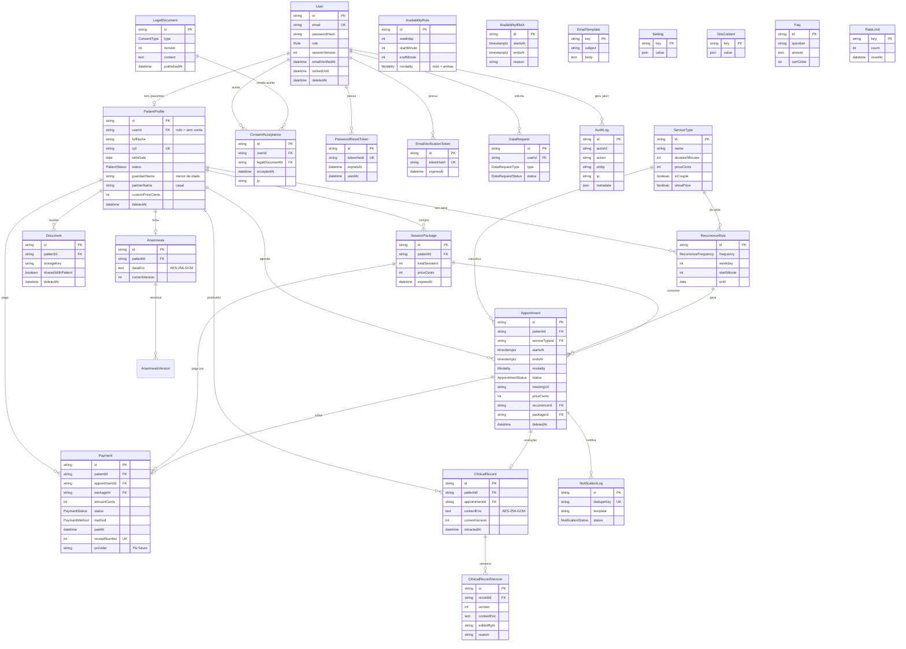

# Arquitetura do Sistema

## 1. Visão geral

```
Navegador ──► Next.js (App Router, Vercel)
               ├─ Site público (RSC, conteúdo vindo do banco)
               ├─ Área do paciente   /paciente/*
               ├─ Painel ADMIN       /admin/*
               ├─ Server Actions (mutações, sempre autorizadas no servidor)
               └─ Route Handlers: /api/auth, /api/cron/*, /api/files/*, /api/recibos/*, /api/export/*
                        │
                        ├─► PostgreSQL (Neon/Supabase) via Prisma
                        ├─► S3 compatível (R2/Supabase Storage) – documentos, via URL assinada
                        └─► Resend (e-mail transacional) – templates React Email
```

Camadas (de dentro para fora):

| Camada         | Pasta                           | Regra                                                                                                                |
| -------------- | ------------------------------- | -------------------------------------------------------------------------------------------------------------------- |
| Domínio (puro) | `src/lib/domain/*`              | Sem I/O. Horários disponíveis, prazos, preço, recorrência. 100% testável.                                            |
| Infra          | `src/lib/*`                     | Prisma, criptografia, e-mail, storage, rate limit, auditoria.                                                        |
| Serviços       | `src/server/*`                  | Casos de uso (agendar, cancelar, registrar prontuário…). Cada um recebe o **usuário autenticado** e checa permissão. |
| Interface      | `src/app/*`, `src/components/*` | Páginas e formulários. Nunca confiam em permissão do front.                                                          |

## 2. Decisões tomadas (onde você não especificou)

Todas seguem "mais segura e mais simples":

1. **Auth.js v5 (beta) com sessão JWT** + `sessionVersion` no usuário. "Sair de todos os dispositivos" incrementa a versão e invalida todos os JWTs. A verificação de versão é feita no servidor (não no middleware edge).
2. **Hash de senha: bcryptjs (custo 12)**, JS puro, sem módulo nativo (funciona na Vercel e no Windows sem compilar).
3. **Rate limiting no próprio PostgreSQL** (tabela `RateLimit`), sem depender de Redis/Upstash. Suficiente para o volume de um consultório.
4. **Anti-duplo-agendamento em duas camadas**: transação `Serializable` + **EXCLUDE constraint** em `tstzrange(startsAt, endsAt)` para sessões que ocupam horário. Mesmo com bug no app, o banco recusa.
5. **Criptografia do prontuário: AES-256-GCM**, chave de 32 bytes em `CLINICAL_ENCRYPTION_KEY`, com prefixo de versão (`v1:`) para permitir rotação futura.
6. **Prontuário nunca é apagado**: "retificação" cria nova versão; "invalidar" apenas marca `retractedAt`. Toda leitura/escrita vai para o `AuditLog`.
7. **Casais**: tipo de serviço com `isCouple`. O paciente titular tem os dados do(a) parceiro(a) (nome/contato) no cadastro. Um prontuário por titular.
8. **Pacote de sessões**: o pacote é pago de uma vez (um `Payment` com `packageId`). Sessões consumidas do pacote não geram cobrança individual; o saldo é calculado.
9. **Paciente sem conta** (cadastro rápido pela psicóloga): é um `PatientProfile` sem `userId`. Quando alguém se cadastra e **confirma** o mesmo e-mail, o perfil é vinculado (só após confirmação, para ninguém "sequestrar" uma ficha).
10. **Lembretes**: endpoint `/api/cron/reminders` protegido por `CRON_SECRET`, chamado a cada 15 min. Na Vercel Hobby o cron nativo é só diário, então fornecemos também um workflow do GitHub Actions (grátis) que chama o endpoint.
11. **Upload**: driver S3 (produção) e driver de disco local (apenas desenvolvimento).
12. **Backup**: workflow agendado do GitHub Actions faz `pg_dump` criptografado para um bucket + guia de restauração. Provedores (Neon/Supabase) também têm backup/PITR próprio.
13. **Datas**: tudo `timestamptz` (UTC). Regras semanais de disponibilidade em "minutos desde 00:00 locais" e convertidas com `America/Sao_Paulo` na hora de gerar slots (respeita mudanças de horário de verão, caso voltem).
14. **Pagamento online**: apenas controle manual agora. O modelo `Payment` já tem `provider`, `externalId`, `pixCopyPaste`, `pixExpiresAt` e há uma interface `PaymentProvider` pronta em `src/lib/payments/`.
15. **PDFs** (recibo e prontuário) com `pdf-lib` (sem navegador headless, roda em serverless).

## 3. Perfis e permissões

| Recurso                          | ADMIN     | SECRETARIA (futuro)           | PACIENTE     |
| -------------------------------- | --------- | ----------------------------- | ------------ |
| Agenda                           | total     | total                         | só as suas   |
| Financeiro                       | total     | total                         | só os seus   |
| Cadastro de pacientes            | total     | leitura/edição administrativa | só o próprio |
| Prontuário / anamnese            | **total** | **nenhum**                    | **nenhum**   |
| Configurações / site / auditoria | total     | nenhum                        | nenhum       |

Implementação: matriz única em `src/lib/permissions.ts` (`can(role, permission)`), usada por todos os serviços. O middleware só faz a primeira barreira (rota por papel); a verdade está nos serviços.

## 4. Estrutura de pastas

```
consultorio-psi/
├─ prisma/
│  ├─ schema.prisma
│  ├─ migrations/               # SQL versionado (inclui a EXCLUDE constraint)
│  └─ seed.ts
├─ public/                      # manifest, ícones, service worker
├─ src/
│  ├─ app/
│  │  ├─ (public)/              # site da psicóloga, termos, privacidade
│  │  ├─ (auth)/                # entrar, cadastro, esqueci/redefinir senha, verificar e-mail
│  │  ├─ paciente/              # área do paciente
│  │  ├─ admin/                 # painel da psicóloga
│  │  └─ api/                   # auth, cron, arquivos, recibos, exportações
│  ├─ components/               # ui (shadcn-style), forms, calendário, gráficos
│  ├─ emails/                   # layout + renderização React Email
│  ├─ lib/
│  │  ├─ domain/                # regras puras (testadas)
│  │  ├─ payments/              # interface para Pix futuro
│  │  └─ *.ts                   # db, crypto, mailer, storage, ratelimit, audit…
│  ├─ server/                    # serviços/casos de uso + server actions
│  └─ middleware.ts
├─ tests/
│  ├─ unit/                     # Vitest
│  └─ e2e/                      # Playwright
├─ scripts/                     # criar admin, gerar ícones, backup
├─ .github/workflows/           # cron de lembretes, backup, CI
└─ docs/                        # arquitetura, deploy, manual da psicóloga
```

## 5. Diagrama do banco (ERD)



`Setting`, `SiteContent`, `Faq`, `EmailTemplate` e `RateLimit` são tabelas de apoio sem relacionamentos.

## 6. Fluxos críticos

**Agendar (paciente)**

1. UI pede `/slots?service=…&modality=…&date=…` → `getAvailableSlots()` (domínio puro) cruza regras semanais − bloqueios − sessões ocupantes, aplica antecedência mínima.
2. Ao confirmar, `bookAppointment()` valida permissão, e-mail confirmado, limite de sessões futuras, recalcula se o slot ainda é válido **dentro da transação** e insere. A constraint do banco é a rede de segurança final (erro `23P01` vira "horário acabou de ser ocupado").
3. Se aprovação manual: status `PENDENTE`; senão `AGENDADA`. Dispara e-mails (paciente + psicóloga) com `.ics` quando confirmado.

**Prontuário**
`salvar` → sanitiza HTML → `encrypt()` → grava versão nova → `AuditLog(CLINICAL_RECORD_UPDATE)`. Leitura: `requireRole(ADMIN)` → `decrypt()` → `AuditLog(CLINICAL_RECORD_READ)`. O texto claro nunca vai para logs.

**Lembretes**
Cron a cada 15 min → seleciona sessões confirmadas/agendadas cuja janela de 24h/2h abriu e `reminderXSentAt IS NULL` → envia → marca. `NotificationLog.dedupeKey` único impede envio duplo mesmo com execuções concorrentes.
